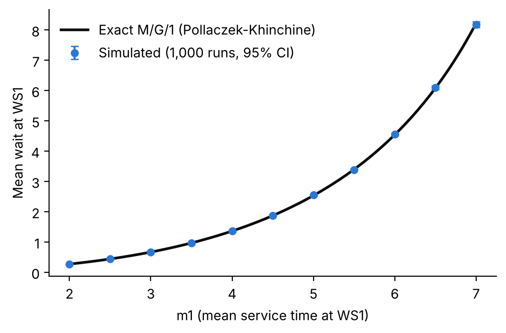

# Fast simulation of a stochastic queueing network

A fast, validated simulator of a four-station queueing network. It was built for a B.Tech research project at IIT Delhi on **simulation metamodelling**: replacing slow stochastic simulations with fast ML surrogate models (such as Gaussian-process regression and neural networks) for capacity planning.

> The surrogate-modelling methods, experiments and results from this project are being prepared for publication and are not included here. This repository holds only the simulation component.

## The system

Customers arrive by a Poisson process, pass through two workstations in series, and are then routed to one of two final stations.

```
Arrivals (Poisson) -> WS1 -> WS2 -> fork: WS3 with probability p
                                          WS4 otherwise
```

| Station | Service time | Input |
|---|---|---|
| WS1 | Uniform(m1 - 1, m1 + 1) | m1 |
| WS2 | Triangular(c - 2, c, c + 2) | c |
| WS3 | Uniform(m3 - 1, m3 + 1) | m3 |
| WS4 | a + b * Beta(2, 2) | a, b |
| Fork | to WS3 with probability p | p |

Outputs per run: the mean wait at each station, the mean time in system, their 90th percentiles, and each station's utilisation.

## How it is fast

Every station is a single-server first-come-first-served queue, so each departure time follows exactly from

```
D_n = max(A_n, D_(n-1)) + S_n
```

which can be computed for all customers at once with cumulative sums, without an event list. One replication of about 1,000 customers takes under a millisecond, hundreds of times faster than a process-based simulator.

Each run discards a warm-up period and follows every counted customer to the end, so averages are not biased by the empty start or by stopping mid-run.

## Validation

`scripts/validate_simulator.py` checks the simulator against queueing theory:
- **WS1 is an M/G/1 queue**, so its mean wait has an exact formula (Pollaczek-Khinchine). The simulated values match it within their confidence intervals over the whole input range.
- **Utilisation** at every station matches the theoretical value, lambda × mean service time.



## Run it

```
pip install -r requirements.txt
python scripts/validate_simulator.py
```

```python
from src.queue_sim import simulate
out = simulate((4, 4, 5, 3, 2, 0.3), runs=60)   # inputs: m1, m3, c, a, b, p
print(out['los'].mean(), out['los'].std())
```

## Repository

| Path | Contents |
|---|---|
| `src/queue_sim.py` | The simulator |
| `scripts/validate_simulator.py` | Checks against queueing theory, writes the figure |
| `results/` | Validation figure |

## Tools

Python, NumPy, Matplotlib.

Author: Vrinda Khandelwal, Production and Industrial Engineering, IIT Delhi.
